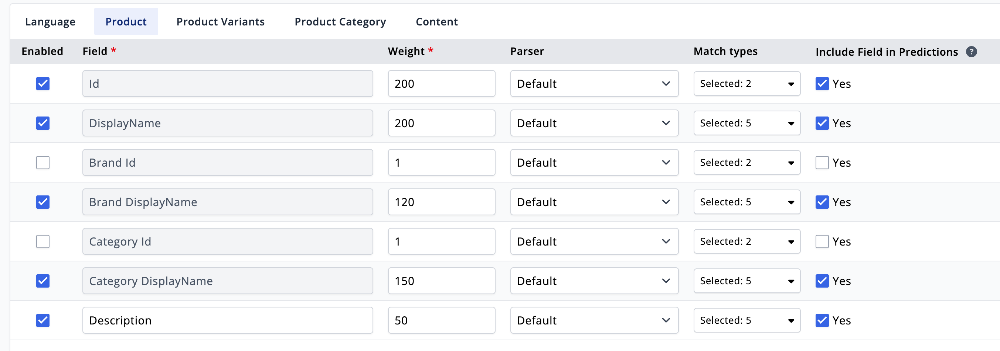
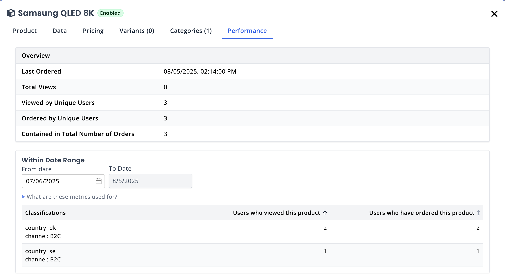

# Relewise Quickstart Tutorial

**Complete guide to implementing Relewise in your TypeScript/JavaScript application**

This tutorial follows the [official Relewise implementation steps](https://docs.relewise.com/docs/developer/implementation-steps.html) and provides hands-on examples with real code you can run immediately.

## 📋 Prerequisites

- Node.js 18+ and npm
- Relewise account with Dataset ID and API Key
- Basic TypeScript/JavaScript knowledge

## 🚀 Step 1: Project Setup

### 1.1 Environment Configuration

Your project includes a pre-configured `.env` file with placeholders. Update it with your Relewise credentials:

```env
# Required: Your Relewise credentials
RELEWISE_DATASET_ID=your-dataset-id
RELEWISE_API_KEY=your-api-key

# Required: Choose API environment
RELEWISE_SERVER_URL=https://sandbox-api.relewise.com  # for testing
# RELEWISE_SERVER_URL=https://api.relewise.com       # for production

# Optional: Defaults
LANGUAGE=en-gb
CURRENCY=EUR
```

#### 🔑 API Key Requirements

Your API Key must have **Read & Write permissions** for:
- **Product search and recommendations** - Required for all search and recommendation examples
- **User tracking and behavioral data** - Required for tracking examples and personalized features
- **Product import/export operations** - Required for product import examples

> **Important:** Start with the sandbox environment (`https://sandbox-api.relewise.com`) for development and testing. You can find your credentials in the Relewise dashboard under Settings > API Keys.

> **Important:** Start with the sandbox environment (`https://sandbox-api.relewise.com`) for development and testing.

### 1.2 Verify Setup

```bash
npm run dev termBasedSearchExample "TV"
```

If successful, you should see a result similar to this (or appropriate error messages).
```json
Products: []
Facets: {
  items: [
    {
      '$type': 'Relewise.Client.DataTypes.Search.Facets.Result.BrandFacetResult, Relewise.Client',
      available: [],
      field: 'Brand'
    },
    {
      '$type': 'Relewise.Client.DataTypes.Search.Facets.Result.PriceRangeFacetResult, Relewise.Client',
      available: [Object],
      priceSelectionStrategy: 'Product',
      field: 'SalesPrice'
    }
  ]
}
Predictions: []
```

> **Note:** Even if you have imported product data, you'll see empty results `Products: []` with facet structure - this is expected and indicates the API connection is working correctly. Reason being that "TV" does not return anything in particular and the index has not yet been configured. 

---

## 📦 Step 2: Data Import with Multi-language Support

_Following [Relewise Implementation Step 1](https://docs.relewise.com/docs/developer/implementation-steps.html#1-provide-entities)_

Before Relewise can provide search and recommendations, it needs your product data. Import your data first, then configure the search index based on what was actually imported.

### 2.1 Understanding Entity Types

Relewise supports these entity types:

- **Products** - Your catalog items
- **Product Categories** - Category hierarchy
- **Content** - Pages, blogs, support articles
- **Content Categories** - Content organization
- **Brands** - Product manufacturers

### 2.2 Run Product Import Example

```bash
npm run dev productImportExample
```

**What this does:**

- Imports sample products from `product_data/product_data_example.json`
- Demonstrates proper product structure with variants, categories, brands
- Shows multilingual data handling (preserves original language tags)
- Uses proper DataValueFactory for different data types

### 2.3 Inspect the Import Code

Look at `src/examples/import/productImportExample.ts`:

```typescript
// Key patterns:
- Product structure with variants
- Category hierarchy setup
- Brand associations
- Multilingual data (en-gb, da-dk, nl, en-se, en-no, en-fi)
- Data types (String, Double, Boolean)
- Update strategies (ReplaceProvidedProperties vs ClearAndReplace)
- Proper language preservation (using element.language not constants)
```

### 2.4 Import Your Own Data

If you would like to import your own data, you would need to refactor the import example to fit your own data structure.<br>
You can choose to follow below guidance. 

1. **Prepare your data** - Use `product_data/product_data_example.json` as a template
2. **Update import script** - Modify `productImportExample.ts` with your data source
3. **Run import** - Execute the import and verify data in My Relewise admin panel

> **Pro Tip:** Start small - import 10-20 products first to test the structure, then scale up.

> **Historical Orders:** If you have existing order history to import for immediate personalization benefits, see [Section 5.3: Historical Data Import Strategy](#53-historical-data-import-strategy) for detailed guidance and working examples.

---

## 🔍 Step 3: Configure Search Index (Based on Imported Data)

**⚠️ Critical**: Configure your search index AFTER importing data so you can see what fields and languages are actually available.

### 3.1 Access Search Index Configuration

1. Log into [My Relewise](https://my.relewise.com)
2. Navigate to Search → Search Index
3. Click "Create New Index" or edit existing

### 3.2 Language Configuration

Configure search for the languages actually present in your imported data:
- **English (en-gb)** - Primary English variant in sample data
- **Danish (da-dk)** - Danish market
- **Dutch (nl)** - Netherlands market  
- **Swedish (en-se)** - Swedish market (English)
- **Norwegian (en-no)** - Norwegian market (English)
- **Finnish (en-fi)** - Finnish market (English)

> **Note:** The sample data uses "en-gb" as the primary English variant, not "en-us".

### 3.3 Field Weight Configuration

Set field importance for search relevance (scale 0-255):
- **Id**: Weight 200 (highest priority)
- **Displayname**: Weight 200 (highest priority)
- **Brand Displayname**: Weight 120 (strong brand matching)
- **Category Displayname**: Weight 150 (category relevance)
- **Description**: Weight 50 (descriptive content)
    - Description need to be added as a "custom field" in the Index configuration, as it resides in the "Data" collection key in the product data structure.
- Tick **Include Field in Predictions** manually.

> **Important:** Field weights use a 0-255 scale where higher numbers = higher importance in search ranking.



### 3.4 Verify Index Status

Wait for index to build (status: "Building" → "Ready"). This can take several minutes depending on data size.

---

## ✅ Step 4: Validation & Troubleshooting

After data import and index configuration, validate everything is working correctly.

### 4.1 Test Data Import Success

Verify your products were imported:
1. Check My Relewise admin panel → Entities → Products
2. Look for your imported products with correct multilingual data
3. Verify categories and brands are properly structured

### 4.2 Test Search Index

```bash
npm run dev termBasedSearchExample "TV"
```

**Expected Results:**
- If successful: Search results with products and facets
- If empty: `Products: []` with facet structure (indicates API connection works, might need more data or different search terms)

### 4.3 Troubleshoot Common Issues

**No search results:**
- ✅ Verify search index status is "Ready" (not "Building")
- ✅ Check that products were imported successfully  
- ✅ Try broader search terms or product names from your actual data
- ✅ Ensure correct `RELEWISE_SERVER_URL` in `.env`

**Import failures:**
- ✅ Validate product data structure against examples
- ✅ Check for missing required fields (id, name, category)
- ✅ Verify language codes match your data format

**API connection issues:**
- ✅ Verify API credentials and permissions
- ✅ Check dataset ID matches your Relewise account
- ✅ Ensure API key has Read & Write permissions

---

## 👤 Step 5: Behavioral Tracking Implementation

_Following [Relewise Implementation Step 2](https://docs.relewise.com/docs/developer/implementation-steps.html#2-add-behavioral-tracking)_

Behavioral tracking is crucial for personalization. Let's implement the essential tracking events.

### 5.1 Complete User Journey Tracking

Run the comprehensive tracking example that demonstrates all essential behavioral events:

```bash
npm run dev basicTrackingExample demo_user_123
```

This example simulates a complete user journey and tracks all the behavioral data that Relewise needs for personalization.

**This example demonstrates:**

- **Product view tracking** - When users view product details
- **Search term tracking** - Search queries and behavior
- **Cart tracking** - Add to cart events
- **Purchase tracking** - Completed orders
- **Category tracking** - Category page visits

**Key tracking patterns:**

```typescript
// Product view tracking
await tracker.trackProductView({
    productId: 'product-123',
    variantId: 'variant-456', // optional
    user: UserFactory.byTemporaryId('demo_user_123'),
});

// Search tracking
await tracker.trackSearchTerm({
    term: 'headphones',
    language: 'en-gb', // Use actual language from your data
    user: UserFactory.byTemporaryId('demo_user_123'),
});

// Cart tracking
await tracker.trackCart({
    user: UserFactory.byTemporaryId('demo_user_123'),
    subtotal: { amount: 299.99, currency: 'EUR' },
    lineItems: [
        {
            productId: 'product-123',
            quantity: 1,
            lineTotal: 299.99,
        },
    ],
});

// Purchase tracking
await tracker.trackOrder({
    user: UserFactory.byTemporaryId('demo_user_123'),
    orderNumber: 'ORD-123',
    subtotal: { amount: 299.99, currency: 'EUR' },
    lineItems: [
        /* same as cart */
    ],
});
```

### 5.2 User Identity Management and Consent

Understanding different user types is critical for GDPR compliance and personalization effectiveness.

**Anonymous Users (no consent given):**

```typescript
const anonymousUser = UserFactory.anonymous();
// Use for: Basic analytics without personal identification
// Limitations: No cross-session personalization
// GDPR: No consent required
```

**Temporary/Session Users (with consent given - meaning "yes" to some or all cookies, but not logged in):**

```typescript
const sessionUser = UserFactory.byTemporaryId('session_' + sessionId);
// Use for: Session-based personalization
// Benefits: Personalization within current session/visit
// GDPR: Basic consent for functional cookies
// Duration: Until session expires
```

**Authenticated Users (Logged in users, regardless of the consent):**

```typescript
const authenticatedUser = UserFactory.byAuthenticatedId('customer_456');
// Use for: Logged-in users with full personalization
// Benefits: Cross-session/device personalization, order history
// GDPR: Full consent for personalization
// Duration: Until user account deletion or consent withdrawal
```

**Best Practices:**
- Anonymous users are always to be used, if no consent is given!
- If any kind of consent is given, but a user is not logged in, use temporary ID.
- Use authenticated ID only after user login and consent.
- Always respect user privacy preferences and consent levels.

### 5.3 Historical Data Import Strategy

For existing businesses with order history, importing historical data provides immediate personalization benefits.

**When to Import Historical Data:**
- You have existing customer order history (last 3-6 months recommended, depending on how often products/catalogues are replaced)
- You want immediate personalization instead of waiting for new behavioral data
- You're migrating from another personalization platform

> **Historical Data Import Approach:** Relewise supports historical data import using the JavaScript SDK's batch functionality. All imported orders will be timestamped with the current import time for analytics tracking, which provides a clean baseline for reporting. To preserve the original order timeline for personalization algorithms, you can include a `"HistoricOrderDate"` data field with the original order date (using `DataValueFactory.string()` with ISO date format). This dual-timestamp approach gives you both accurate import tracking and proper personalization weighting.

> **Personalization Timeline Preservation:** When you include the `HistoricOrderDate` data field, Relewise's recommendation algorithms will use these dates for proper weighting and decay, ensuring older orders have appropriate influence compared to newer ones. This means your recommendations will reflect the true customer journey timeline. Revenue analytics will show orders as imported on the current date (providing clear audit trails), while personalization respects the historical timeline. The Relewise Support team can assist with configuring custom weighting strategies for your specific business needs. 

**Option 1: Use the Provided Example Script**

We've included a complete historical data import example with sample order data:

```bash
npm run dev historicalDataImportExample
```

This script demonstrates:
- Loading historical orders from `product_data/historical_orders_example.json`
- Multi-market order patterns (DK, SE, NO, GB)
- B2B and B2C customer segmentation
- Rate limiting and batch processing
- Progress tracking and error handling

**Option 2: Bulk Historical Import (For your own data)**

For importing your own historical order data:

```typescript
// Import historical orders for immediate personalization baseline
const historicalOrders = await loadOrdersSince('2024-01-01');

// Process in batches to avoid API rate limits
const batchSize = 100;
for (let i = 0; i < historicalOrders.length; i += batchSize) {
    const batch = historicalOrders.slice(i, i + batchSize);
    
    const trackableOrders = batch.map(order => ({
        $type: 'Relewise.Client.DataTypes.Order, Relewise.Client',
        orderNumber: order.orderNumber,
        user: UserFactory.byAuthenticatedId(order.customerId),
        subtotal: { amount: order.total, currency: { value: order.currency } },
        lineItems: order.items.map((item) => ({
            product: { id: item.productId },
            quantity: item.quantity,
            lineTotal: item.lineTotal,
        })),
        // Use data field to preserve historical order date for recommendation weighting
        data: {
            'HistoricOrderDate': DataValueFactory.string(new Date(order.orderDate).toISOString())
        }
        // Note: Order will be timestamped with current import time in analytics
        // but Relewise will use HistoricOrderDate for personalization algorithms
    }));
    
    // Use integrator.batch() for bulk order import
    await integrator.batch(trackableOrders);
    
    // Rate limiting - pause between batches
    await new Promise(resolve => setTimeout(resolve, 1000));
}
```

**Option 3: Gradual Import (For smaller datasets)**

```typescript
// Import gradually during low-traffic periods
const customers = await getAllActiveCustomers();

for (const customer of customers) {
    const customerOrders = await getCustomerOrders(customer.id, { since: '2024-01-01' });
    
    const trackableOrders = customerOrders.map(order => ({
        $type: 'Relewise.Client.DataTypes.Order, Relewise.Client',
        orderNumber: order.orderNumber,
        user: UserFactory.byAuthenticatedId(customer.id),
        subtotal: { amount: order.total, currency: { value: order.currency } },
        lineItems: order.items.map(item => ({
            product: { id: item.productId },
            quantity: item.quantity,
            lineTotal: item.lineTotal,
        })),
        // Use data field to preserve historical order date for recommendation weighting
        data: {
            'HistoricOrderDate': DataValueFactory.string(new Date(order.orderDate).toISOString())
        }
        // Note: Order will be timestamped with current import time in analytics
        // but Relewise will use HistoricOrderDate for personalization algorithms
    }));
    
    // Use integrator.batch() for bulk order import
    await integrator.batch(trackableOrders);
}
```

**Historical Import Best Practices:**
- **Time Range**: Import 3-6 months of data (more recent = more relevant)
- **Data Quality**: Ensure product IDs match your current catalog
- **Rate Limiting**: Don't overwhelm the API - batch and add delays
- **Incremental**: Start with your most valuable customers first
- **Validation**: Verify import success in My Relewise dashboard (The Perfomance tab on a product in MyRelewise).
- **Historical Dating**: Use `data: { 'HistoricOrderDate': DataValueFactory.string(originalDate) }` to preserve order dates for recommendation weighting
- **Analytics vs Personalization**: Revenue will show on import date, but recommendations will respect historical timeline
- **Contact Relewise**: For advanced historical import scenarios, consult with Relewise support



> **Important**: Historical data import should be done ONCE during initial setup. After going live, use real-time tracking only.

---

## 🔍 Step 6: Implement Search Services

_Following [Relewise Implementation Step 3](https://docs.relewise.com/docs/developer/implementation-steps.html#3-implement-services)_

Now that you have data, index configuration, and tracking, implement search functionality.

### 6.1 Basic Product Search

```bash
npm run dev termBasedSearchExample "headphones"
```

**Key features demonstrated:**

- Term matching and relevance
- Faceted navigation (brands, categories, price ranges)
- Pagination
- Search term predictions for typeahead

### 6.2 Category-Based Search

```bash
npm run dev searchCategoryExample "5"
```

> **Note**: Use category ID "5" (Hi-Fi category) from the sample data. To find available category IDs, check the imported data in My Relewise admin panel or look at `product_data_example.json`.

**What this shows:**

- Category hierarchy navigation
- Category-specific facets
- Breadcrumb navigation
- Category-scoped search

**Troubleshooting Category Search:**
- If no results: Verify category ID exists in your imported data
- Check My Relewise admin panel → Entities → Product Categories for available category IDs
- Ensure search index includes category fields

### 6.3 Personalized Search with CDP Integration

Connect this to the user from tracking examples:

```bash
npm run dev cdpPersonalizedSearchExample demo_user_123 "headphones"
```

> **Important**: Use the same `demo_user_123` from Step 5 tracking examples to see how behavioral data influences search personalization.

**Advanced features:**

- User-specific personalization based on tracked behavior
- External data integration (CDP, weather, ML models)
- Relevance modifiers based on user preferences
- Context-aware boosting

**How Personalization Works:**
1. User `demo_user_123` behavioral data from tracking (Step 5)
2. Search results are modified based on user's tracked preferences
3. Products user previously viewed/purchased get relevance boosts
4. Category preferences influence result ordering

---

## 🎯 Step 7: Implement Recommendations

Recommendations drive engagement and conversions. Let's implement key recommendation types.

### 7.1 Popular Products

```bash
npm run dev popularProductsExample
```

**Use cases:**

- Homepage recommendations
- Category landing pages
- Empty cart suggestions

### 7.2 Cross/Upsell Products

```bash
npm run dev purchasedWithProductExample "00198c54-6c62-4e08-be40-a539963985d0"
```
**Use cases:**

- Product detail pages ("Customers also bought")
- Cross-selling in cart
- Related product suggestions

### 7.3 Recommendation Placement Strategy

**Best practices for where to place recommendations:**

- **Homepage:** Popular products, trending items
- **Product Pages:** Related products, purchased-with products
- **Cart Page:** Cross-sell items, bundle suggestions
- **Checkout:** Last-minute add-ons
- **Post-Purchase:** Complementary products

---

## 🔄 Step 8: Updating and Maintaining Data

_Following [Relewise Implementation Step 4](https://docs.relewise.com/docs/developer/implementation-steps.html#4-updating-entities)_

Your product catalog changes - here's how to keep Relewise in sync.

### 6.1 Delta Updates (Recommended)

For ongoing updates, track what changed since last sync:

```typescript
// Update only products that changed today
const changedProducts = await getProductsChangedSince(yesterday);
for (const product of changedProducts) {
    await integrator.updateProduct(product, {
        updateKind: 'ReplaceProvidedProperties',
    });
}
```

### 6.2 Full Updates with Timestamp Strategy

For complete catalog refresh:

```typescript
const timestamp = new Date().toISOString();

// 1. Update all products with timestamp
await importAllProducts(timestamp);

// 2. Disable products without latest timestamp
await integrator.batchUpdateProducts({
    filter: new FilterCollection(
        new ProductDataFilter(
            'ImportedAt',
            new EqualsCondition(timestamp, true), // negated: true
        ),
    ),
    action: ProductAdministrativeAction.UpdateKind.Disable,
});

// 3. Enable products with latest timestamp
await integrator.batchUpdateProducts({
    filter: new FilterCollection(
        new ProductDataFilter('ImportedAt', new EqualsCondition(timestamp, false)),
    ),
    action: ProductAdministrativeAction.UpdateKind.Enable,
});
```

### 6.3 Update Strategies

- **UpdateAndAppend** - Adds new fields, keeps existing
- **ReplaceProvidedProperties** - Updates provided fields only
- **ClearAndReplace** - Complete replacement (use carefully)
- **None** - No changes to main product (useful for variant-only updates)

---

## ✅ Production Readiness Checklist

Before going live, ensure you have completed:

- [ ] **Environment variables** set for production
- [ ] **Search index** configured and built with proper field weights
- [ ] **Product data** imported successfully with correct multilingual handling
- [ ] **Tracking implemented** on all key pages
- [ ] **Error handling** implemented for API calls
- [ ] **Fallbacks** in place if Relewise is unavailable
- [ ] **Monitoring** setup for API errors and performance

---

## 🔧 Advanced Configuration

### Environment-Specific Setup

**Development:**

```env
RELEWISE_SERVER_URL=https://sandbox-api.relewise.com
LANGUAGE=en-gb
CURRENCY=EUR
```

**Production:**

```env
RELEWISE_SERVER_URL=https://api.relewise.com
LANGUAGE=en-gb
CURRENCY=EUR
```

### Performance Optimization

- **⚠️ Do NOT Cache Search/Recommendation Results** - Relewise results are personalized and should never be cached as this defeats personalization
- **Batching** - Batch tracking calls when possible to reduce API overhead
- **Fallbacks** - Always have fallback content ready in the unlikely event that Relewise is unavailable

### Monitoring and Analytics

- **API Response Times** - Monitor search/recommendation latency
- **Error Rates** - Track failed API calls
- **Conversion Impact** - Measure business impact of personalization
- **Data Quality** - Monitor product data completeness

---

## 🆘 Troubleshooting

### Common Issues

**No search results:**

- Verify search index is configured and built
- Check product data was imported successfully
- Ensure correct RELEWISE_SERVER_URL

**Tracking not working:**

- Verify API credentials and permissions
- Check user identification setup
- Ensure proper event structure

**Import failures:**

- Validate product data structure against examples
- Check for missing required fields
- Verify data type formatting

### Getting Help

- **Documentation:** [docs.relewise.com](https://docs.relewise.com)
- **API Reference:** [Swagger API docs](https://docs.relewise.com/swagger/index.html)
- **Support:** Contact Relewise support team
- **Community:** Join Relewise Slack community

---

## 🎉 Next Steps

Congratulations! You now have a deep understanding of how to create a working Relewise implementation with:

✅ **Complete Entity Management** - Product import with real multilingual data structure  
✅ **Search Index Configuration** - Properly configured field weights and language support  
✅ **Behavioral Tracking** - Full user journey tracking (views, searches, cart, purchases)  
✅ **Search Implementation** - Basic, category, and personalized search with CDP integration  
✅ **Recommendations** - Popular products and collaborative filtering  
✅ **Production-Ready Patterns** - Shared configuration, error handling, type safety

### What You've Built

**1. Comprehensive Examples Library**

- 📊 `basicTrackingExample` - Complete behavioral tracking
- 📥 `productImportExample` - Real multilingual product data import
- � `historicalDataImportExample` - Historical order data import with multi-market patterns
- �🔍 `termBasedSearchExample` - Basic product search with facets
- 🔍 `searchCategoryExample` - Category-based navigation
- 🔍 `cdpPersonalizedSearchExample` - Advanced personalization with external data
- 🎯 `popularProductsExample` - Popularity-based recommendations
- 🎯 `purchasedWithProductExample` - Collaborative filtering

**2. Architecture**

- Shared configuration eliminating code duplication
- Environment-driven settings for multiple deployments
- Type-safe external data integration patterns
- Comprehensive error handling and fallbacks
- Real product data aligned with your actual catalog

**3. Advanced Integration Patterns**

- CDP (Customer Data Platform) integration
- External API simulation (weather, social trends, ML models)
- Relevance modifiers with proper SDK syntax
- Multi-language and multi-currency support
- Development guidelines preventing SDK syntax errors

### Immediate Next Steps

1. **Customize for Your Use Case**
   - Replace sample data with your actual product catalog
   - Modify tracking examples to match your website structure
   - Adjust search and recommendation logic for your business needs

2. **Production Implementation**
   - Configure production environment variables
   - Set up proper error handling and monitoring
   - Implement fallback content for when Relewise is unavailable
   - Add performance monitoring for search and recommendation response times

3. **Business Optimization**
   - Monitor conversion impact of personalization
   - Fine-tune search field weights based on user behavior
   - Optimize recommendation placement for maximum engagement
   - Set up dashboards for tracking personalization performance

### Advanced Features to Explore

- **Content search** - Implement search for blogs, support articles
- **Multi-language expansion** - Setup for additional international markets
- **B2B features** - Company-based personalization and catalogs
- **Performance optimization** - Query and API optimizations

### Important Reminders

- **Never cache personalized results** - Relewise results are user-specific
- **Respect user privacy** - Always implement proper consent management
- **Monitor data quality** - Regularly validate import data for accuracy
- **Stay updated** - Keep SDK versions current for latest features

---

**🚀 Happy building with Relewise!**

_This tutorial covers the essential implementation steps following [official Relewise implementation guidelines](https://docs.relewise.com/docs/developer/implementation-steps.html). For production use, review the [Best Practices documentation](https://docs.relewise.com/docs/developer/bestpractices/) and consult with your Relewise account team._
